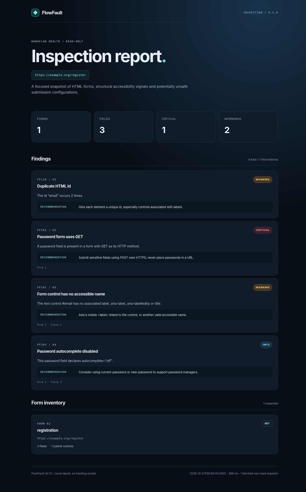

# FlowFault

**Break your workflows before your users do.**

FlowFault is an open-source CLI for discovering HTML forms and finding explainable, structural reliability problems. It inspects a page in a temporary Chrome session, blocks non-GET/HEAD requests on the inspected page target, and generates shareable JSON and self-contained HTML reports.

> **v0.1.0 is a page/form inspector, not yet an end-to-end workflow simulator.** It does not submit forms, test live delivery, assess full WCAG compliance, verify authentication or guarantee your site is secure.

## Why FlowFault?

A registration page can render perfectly and still hide problems that frustrate users: a field without a real label, a duplicate `id`, or a password submitted using `GET`. FlowFault provides a compact, repeatable inspection record for these issues with actionable recommendations.

The project is designed to grow into workflow-level failure testing. Each release will add testable capabilities without relying on opaque scoring.

## Report preview

The image below comes from FlowFault's actual HTML report renderer, using **synthetic sample data**.



To explore the local example without running a browser scan, open `examples/sample-report.html`.

## Highlights in 0.1.0

- Real-browser discovery of forms, visible controls, label association and form methods.
- A small set of transparent diagnostics with stable rule identifiers.
- Network interception that blocks browser POST/PUT/PATCH/DELETE requests on the inspected CDP page target.
- Human-readable CLI output, JSON for automation and an offline HTML report.
- No npm runtime dependencies, no cloud account, no telemetry and no form value collection.
- Optional CI failure threshold (`--fail-on warning` or `--fail-on critical`).

## Quick start

Requirements: **Node.js 22+** and **Google Chrome / Chromium** installed.

```bash
npm ci
npm test
npm run typecheck
npm run build
node dist/cli.mjs doctor
node dist/cli.mjs inspect http://127.0.0.1:3000/register --json reports/register.json --html reports/register.html
```

Or run a built-in, local-only example:

```bash
npm run demo
open reports/demo.html        # macOS
```

Once linked as a command:

```bash
npm link
flowfault inspect https://example.com/register --json reports/result.json --html reports/result.html
```

Only inspect targets you control or have permission to inspect. Running against live third-party services can still trigger GET requests and fetch page assets.

## CLI

```text
flowfault inspect <url> [--json <file>] [--html <file>]
                      [--timeout <ms>] [--wait <ms>]
                      [--fail-on none|warning|critical] [--chrome <path>]
flowfault doctor
flowfault --help
```

CLI exit codes: `0` successful inspection, `1` setup/runtime error, `2` a configured severity threshold was reached.

If Chrome is installed in a nonstandard location:

```bash
FLOWFAULT_CHROME_PATH="/path/to/Google Chrome" npm run demo
```

The `npm run typecheck` command performs dependency-free JavaScript syntax verification. **It is not a TypeScript type checker**, because the v0.1 core is written in standard JavaScript ESM. Unit tests exercise the report and rule contracts.

## Included diagnostics

| Code | Level | Detection |
| --- | --- | --- |
| FF001 | Info | No HTML form detected |
| FF002 | Warning | Snapshot exceeded v0.1 collection limits |
| FF101 | Warning | Input, textarea or select without accessible name |
| FF110 | Warning | Duplicate element id |
| FF120 | Info | Form has no visible inspectable fields |
| FF121 | Info | Form has no explicit submit control |
| FF201 | Critical | Password field in a GET form |
| FF202 | Critical | HTTPS page with HTTP form action |
| FF203 | Info | Password autocomplete disabled |

See [rule notes](docs/rules.md) for intent and limitations.

## Project structure

```text
src/cli.mjs             CLI entry point
src/lib/chrome.mjs      Browser discovery and isolated Chrome launcher
src/lib/cdp.mjs         Small Chrome DevTools Protocol client
src/lib/collector.mjs   Browser-side passive DOM inventory
src/lib/inspect.mjs     Scan orchestration and sanitized snapshots
src/lib/analyze.mjs     Explainable diagnostic rules
src/lib/report.mjs      JSON and offline HTML report generators
scripts/                Build, demo, checks and integration fixture
.github/workflows/      GitHub Actions verification
```

## Roadmap

- **v0.1.0** — passive form inspection and static reports.
- **v0.2.0** — controlled network delay / failure simulations for staging environments.
- **v0.3.0** — interactive dashboard and comparable scans.
- **v0.4.0** — retry and duplicate-submission checks on approved test environments.
- **v0.5.0** — workflow event tracing SDK for frontend and backend.
- **v1.0.0** — stable workflows, public API and plugin lifecycle.

These are intended milestones, not features already shipped.

## Development and safety

Run `npm test` for offline unit tests, `npm run typecheck` for JS static syntax checking, `npm run build` to create `dist`, and `npm run test:integration` to exercise a real local Chromium fixture. A managed or restricted Chrome installation may disallow local page navigation; in that case the integration test cannot run and should not be marked as passed.

See [CONTRIBUTING.md](CONTRIBUTING.md), [SECURITY.md](SECURITY.md) and [CHANGELOG.md](CHANGELOG.md).

## License

MIT. Copyright (c) 2026 Moataz Kobry and contributors.
